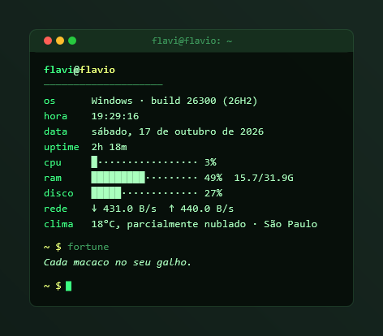
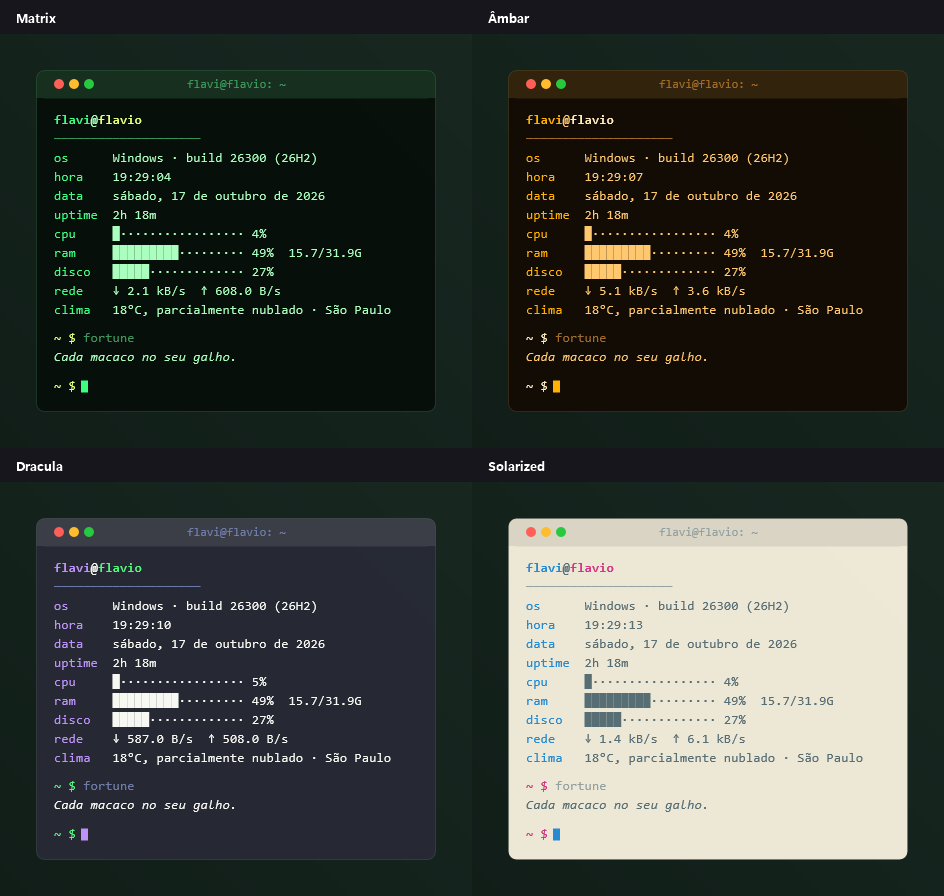
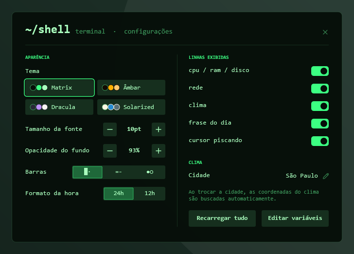

# Shell

**Uma janela de terminal no estilo neofetch com as informações do seu PC.**

Skin para o [Rainmeter](https://www.rainmeter.net), minimalista e com tela de configurações própria.

[**⬇ Baixar Shell.rmskin**](https://github.com/flavioferr/rainmeter-shell/releases/latest/download/Shell.rmskin)

## Sobre

O Shell mostra usuário@computador, build do Windows, hora, data, uptime, barras de texto para CPU/RAM/disco, rede, clima e uma frase do dia, tudo em fonte monoespaçada e com cursor piscando.

## Widgets

| Widget | O que mostra |
|---|---|
| **Terminal** | informações do sistema em linhas, cada linha pode ser ligada/desligada |

## Temas

## Configurações

Clique com o botão direito em qualquer widget → **Configurações**. Tudo é salvo na hora.

- 4 temas: Matrix, Âmbar, Dracula e Solarized
- Tamanho da fonte
- Estilo das barras: blocos, traços ou bolinhas
- Linhas exibidas e cursor piscando
- Opacidade, 24h/12h e cidade

## Instalação

1. Instale o [Rainmeter](https://www.rainmeter.net) (4.5 ou mais novo).
2. Baixe o [`Shell.rmskin`](https://github.com/flavioferr/rainmeter-shell/releases/latest) na página de Releases.
3. Dê dois cliques no arquivo e clique em **Install**.
4. Na primeira vez, os widgets aparecem já posicionados e as configurações abrem sozinhas.

Instalação manual: copie a pasta [`Shell`](Shell) para `Documentos\Rainmeter\Skins` e carregue pelo gerenciador do Rainmeter.

## Dicas

- **Clima:** digite sua cidade nas configurações; as coordenadas são buscadas sozinhas (se não encontrar, tente sem acento). Os dados vêm do [Open-Meteo](https://open-meteo.com), gratuito e sem chave de API.
- **Mover:** arraste os widgets com o mouse.
- **Ajustes avançados:** o botão *Editar variáveis* abre o `@Resources/Variables.inc`.

## Requisitos

Windows 10 ou 11 e Rainmeter 4.5+. As fontes (Segoe UI Variable, Segoe Fluent Icons, Bahnschrift, Georgia, Consolas) já vêm com o Windows 11.

## Coleção

Outras skins da mesma coleção:

- [Lumen](https://github.com/flavioferr/rainmeter-lumen) — Cartões escuros e minimalistas: relógio, sistema, rede, clima e atalhos.
- [Horizon](https://github.com/flavioferr/rainmeter-horizon) — Uma barra de status fina e flutuante no topo (ou no rodapé) da tela.
- [Orbit](https://github.com/flavioferr/rainmeter-orbit) — Relógio analógico e medidores circulares com gradiente neon.
- [Folio](https://github.com/flavioferr/rainmeter-folio) — Tipografia editorial com serifa, sem caixas, como uma página de revista.
- [Bento](https://github.com/flavioferr/rainmeter-bento) — Uma grade de blocos coloridos com relógio, calendário, clima e sistema.
- [Prisma](https://github.com/flavioferr/rainmeter-prisma) — Uma barra lateral de vidro fosco na altura da tela.
- [Linea](https://github.com/flavioferr/rainmeter-linea) — Linhas de progresso do dia, da semana, do mês e do ano, mais a linha do sol.
- [Pixel](https://github.com/flavioferr/rainmeter-pixel) — Um relógio em matriz de pontos numa tela de LCD retrô.
- [Soft](https://github.com/flavioferr/rainmeter-soft) — Painéis em relevo (neumorfismo) com um termostato circular para o clima.
- [Swiss](https://github.com/flavioferr/rainmeter-swiss) — Um pôster tipográfico suíço com horas gigantes e a faixa da semana.
- [Island](https://github.com/flavioferr/rainmeter-island) — Uma pílula no topo da tela que se expande com animação ao passar o mouse.

## Licença

[CC BY-NC-SA 4.0](LICENSE.md) — use, modifique e compartilhe, dando crédito e sem fins comerciais.
